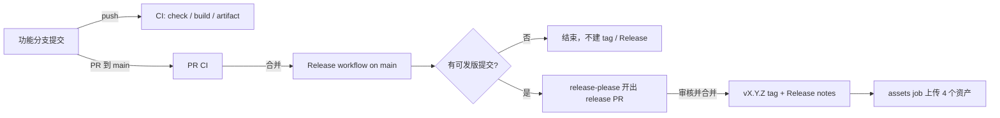

# 提交、PR 与自动发布流程

> 本文是日常「怎么提交、怎么合并、怎么发版」的操作说明。CI / Release 的工作流细节见 [README.md 的「CI 与发布」](./README.md#ci-与发布)，实施计划与验收记录见 [todo.md](./todo.md)。

## 一句话流程

在功能分支用 **Conventional Commits** 提交 → 通过 PR 合并到 `main` → release-please 自动开 release PR → 审核并合并 release PR → 自动创建 `vX.Y.Z` tag、GitHub Release 与 4 个资产。



## 当前状态

- 最新正式版本：`0.2.1`；已存在 `v0.1.0`、`v0.2.0`、`v0.2.1` tag 与同名 GitHub Release。
- `package.json` 的 `version` 是唯一版本源；不要手改版本号。
- 仓库已开启 **Allow GitHub Actions to create and approve pull requests**。
- 当前**未配置** `RELEASE_PLEASE_TOKEN` secret，因此 release PR 的 CI 需要通过 **Approve workflows to run** 人工批准；配置 PAT 后可自动运行。
- npm 包 `github-cursor-trail` 已发布到官方源；固定版本 CDN 示例已生效，也可从 GitHub Releases 下载 `.tgz` 离线本地安装。

## 1. 开始改动前

```bash
git switch main
git pull --ff-only origin main
git switch -c fix/描述问题
# 或 feat/描述功能、docs/描述文档、chore/描述杂项

pnpm install --frozen-lockfile --config.minimum-release-age=0
```

`--config.minimum-release-age=0` 用于绕过 pnpm 12 对刚发布依赖的供应链策略校验。CI 与 Release 工作流也使用同一条命令。

> 若本地 `pnpm` 命令只因 Corepack 补写了 `@pnpm/exe` 相关条目而修改 `pnpm-lock.yaml`，执行 `git restore pnpm-lock.yaml`；若生成 `pnpm-workspace.yaml`，删除它。不要提交这些文件。

## 2. 提交信息决定版本号

提交信息必须使用 [Conventional Commits](https://www.conventionalcommits.org/)，例如：

```text
fix: 修复窄屏下方块尺寸计算
feat: 支持自定义颜色池
docs: 补充接入示例
chore: 调整本地工具配置
```

以当前 `0.2.1` 为例（实际版本请以 `package.json` 为准）：

| 提交类型 | 下一个版本 | tag |
| --- | --- | --- |
| `fix:`、`perf:` | `0.2.2` | `v0.2.2` |
| `feat:` | `0.3.0` | `v0.3.0` |
| `feat!:` 或正文含 `BREAKING CHANGE:` | `1.0.0` | `v1.0.0` |
| `docs:` / `chore:` / `ci:` / `test:` / `refactor:` / `style:` | 不产生新版本 | — |
| 正文含 `Release-As: 0.4.0` | 强制 `0.4.0` | `v0.4.0` |

说明：

- 当前配置未启用 `bump-minor-pre-major` / `bump-patch-for-minor-pre-major`，所以 0.x 下 `feat` 仍升 minor，破坏性变更直接升 major。
- 多个可发版提交会合并到同一个 release PR，并按最高级别计算版本：`fix + feat → minor`，含破坏性变更 → `major`。
- `docs:` / `chore:` / `ci:` 等提交仍会跑 CI，但不会创建 release PR、tag 或 Release。
- 需要跳跃版本时才在提交正文写 `Release-As: X.Y.Z`：

  ```bash
  git commit -m "fix: 紧急修复" -m "Release-As: 0.4.0"
  ```

- 若由 Copilot 协助生成提交，保留 `Co-authored-by: Copilot <223556219+Copilot@users.noreply.github.com>` trailer。

## 3. 本地校验

```bash
pnpm check
pnpm build
npm pack --dry-run
```

预期结果：

- `pnpm check` 通过，且 `pnpm-lock.yaml` 没有实际业务改动。
- `pnpm build` 后 `dist/` 恰好 7 个文件；`dist/demo.html` 引用 `./cursor-trail.umd.js`，不含 `CURSOR_TRAIL_ENTRY`。
- `npm pack --dry-run` 显示 11 个文件：7 个 `dist/` 产物、`src/index.ts`、`README.md`、`LICENSE`、`package.json`。
- 不提交 `dist/`、`build/`、`coverage/`、`pnpm-workspace.yaml`。

## 4. 推送并开 PR

```bash
git add <改动文件>
git commit -m "fix: 修复窄屏下方块尺寸计算"
git push -u origin fix/描述问题
```

然后在 GitHub 上向 `main` 开 PR。

PR 标题很重要：

- 推荐让 PR 标题本身就是 Conventional Commit，例如 `feat: 支持自定义颜色池`。
- 如果使用 **Squash and merge**，最终落到 `main` 的提交标题就是 squash 标题，必须保留 `feat:` / `fix:` 等前缀；不要压成 `Update README` 或 `Merge pull request #...`。
- 如果使用 **Create a merge commit** 或 **Rebase and merge**，也要确保原始提交信息保留 Conventional Commit 前缀。
- 直接 push 到 `main` 技术上也能触发流程，但会跳过 PR 审核，不推荐。

PR 会触发 `CI`：安装依赖 → `pnpm check` → `pnpm build` → 校验 `dist/` → 上传 `dist-<sha>` Actions artifact（14 天）。PR 不创建 tag、不创建 GitHub Release、不发布 npm。

## 5. 合并到 `main` 后发生什么

`main` 上的每次 push 都会触发 `Release` 工作流中的 release-please job：

- 没有可发版提交：不创建 release PR，也不创建 tag / Release。
- 有 `fix:` / `feat:` / 破坏性变更：release-please 开出或更新标题为 `chore(main): release X.Y.Z` 的 release PR。
- release PR 自动修改且只应修改这些版本文件：

  | 文件 | 变化 |
  | --- | --- |
  | `package.json` | `version` |
  | `CHANGELOG.md` | 新增对应版本章节 |
  | `README.md` | 两行带 `x-release-please-version` 注解的 CDN 版本号 |
  | `.release-please-manifest.json` | 版本锚点 |

不要手工编辑以上文件来「提前发版」。

## 6. 审核并合并 release PR

1. 检查版本号是否符合预期，以及 `CHANGELOG.md` 是否只包含本次待发布提交。
2. 等待 CI 通过。
   - 已配置 `RELEASE_PLEASE_TOKEN`：CI 自动运行。
   - 当前未配置：在 Actions 中打开该 release PR 的 CI run，点击 **Approve workflows to run**，等待其通过。
3. 合并 release PR。合并时 release-please 创建 `vX.Y.Z` tag 与带生成 notes 的 GitHub Release；同一工作流的 `assets` job 检出该 tag、重新构建并上传 4 个资产：`.zip`、`.tar.gz`、`.tgz`、`SHA256SUMS.txt`。
4. 不需要再手动运行 `workflow_dispatch`，也不要手动 `git tag` 或 `pnpm version`。

### 推荐补齐 PAT（可选但符合原计划）

仓库管理员可创建仅授权本仓库的细粒度 PAT：

- `metadata: read`
- `contents: read/write`
- `pull requests: read/write`

将其保存为 GitHub Actions secret `RELEASE_PLEASE_TOKEN` 并登记轮换日期。配置后，release PR 的 CI 会自动运行，不再需要人工批准。

## 7. 发布后验证

从 GitHub Releases 下载对应版本的 4 个资产，在同一目录执行：

```bash
sha256sum -c SHA256SUMS.txt
pnpm add ./github-cursor-trail-X.Y.Z.tgz
```

`.zip` / `.tar.gz` 解压后应包含：

- `dist/` 7 个文件
- `src/index.ts`
- `README.md`
- `LICENSE`
- `package.json`

`dist/demo.html` 仍通过相对路径引用 `./cursor-trail.umd.js`，可直接打开。

## 8. 资产缺失或需要为已有 tag 补建 Release

在 GitHub Actions 中手动运行 **Release** 工作流：

- 分支：`main`
- 输入 `tag`：必须填写**已经存在**的 tag，例如 `v0.2.1`

该流程会检出该 tag、重新构建、以 `--clobber` 覆盖同名资产；如果 Release 尚不存在，会用 `--generate-notes --verify-tag` 补建。重复运行不会产生重复资产。

> Tag push 不会触发 CI / Release；两条工作流都带 `branches` 过滤器，资产上传在创建 Release 的同一工作流内完成。

## 9. 不要做的事

- 不要手动 `git tag`、`pnpm version`、`npm version`。
- 不要手改 `package.json` 的 `version`、`CHANGELOG.md`、README CDN 版本行或 `.release-please-manifest.json`。
- 不要把 `dist/`、Actions artifact 或本地 `build/` 提交进仓库。
- 不要用非 Conventional Commit 标题 squash 合并功能 PR，否则 release-please 可能无法推导版本。
- 不要在普通功能 PR 中期待 GitHub Release；PR 只产出 Actions artifact。
- 不要依赖 tag push 触发第二个发布工作流；当前设计刻意不这么做。
