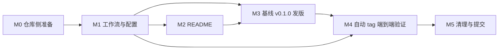

# github-cursor-trail CI / 自动发布计划

> 状态：**决策与仓库事实已全部确认 · 待实施** · 更新日期：2026-11-06 · 本文是实施计划与验收依据，完成一项勾选一项。
> 上一阶段计划（M0–M6 已完成）保留在 git 历史中，用 `git show HEAD:todo.md` 可查看；本计划承接其 §11「下一计划」中的 CI / Release 部分，原始需求见 §8。
> **§3 关键决策与 §9 的 Q1–Q8 均已按推荐方案拍板**；仓库亦已确认 **未启用 immutable releases**（2026-11-06），因此走 §6.3 默认非 draft 流程，无需 `draft` / `force-tag-creation`。实施时不再有待确认项。
> **核心结论：要自动打版本号 tag，但不是「每次 push 自动 +1」**——采用 Conventional Commits + release-please，合并 release PR 时自动创建 `vX.Y.Z` tag 与 GitHub Release，详见 §3 / §6.1 / §9-Q1。
> 本轮只更新计划文档；`.github/workflows/` 等文件按 §5 的 M1 阶段、依 §6 草图创建，范围不含 npm 发布与 GitHub Pages（见 §11）。

## 1. 目标与约束

- **目标**：新增 GitHub Actions 配置，使 `push` 与 `pull_request` 都自动执行 `pnpm check` + `pnpm build`；把构建产物作为资产输出到 **GitHub Releases**；建立可自动打版本号 tag 的发布流程。
- **保持兼容**：`src/index.ts`、`demo.html`、`scripts/build-demo.mjs`、两份 Vite 配置、两份 tsconfig、`LICENSE`、`pnpm-lock.yaml` 一律不改；`dist/` 仍是恰好 7 个文件；`pnpm build` 顺序（`build:lib → build:types → build:demo`）不变；`pnpm check` 必须继续通过。
- **不引入**：任何运行时依赖、任何新的 devDependency、任何需要提交到仓库的构建产物。release-please 是 GitHub Action，不是 npm 包，因此 `pnpm-lock.yaml` 不变。
- **只在发布时产出 Release**：普通 push / PR 只产出 **Actions artifact**（用于 PR 验证与临时下载），不创建 GitHub Release、不创建 tag、不发布 npm。
- **版本号唯一真相源**：`package.json` 的 `version`；tag 形如 `v0.1.1`（带 `v`、不带包名前缀）；`CHANGELOG.md` 与 README 中的 CDN 版本号由 release-please 同步，不手工维护。
- **安全约束**：工作流按 job 最小化 `permissions`；CI 不接触任何 secret、不用 `pull_request_target`；第三方 action 固定到 commit SHA；fork PR 只读、不能触发发布。
- **收尾**：全部改好后清理临时文件并提交，提交信息带 `Co-authored-by: Copilot <223556219+Copilot@users.noreply.github.com>`（见 M5）。

## 2. 现状盘点（截至 2026-11-06）

| 项 | 现状 | 处理方向 |
| --- | --- | --- |
| Git | 仅 `main` 分支、未设分支保护；HEAD `41cbf64`，共 4 个提交；**无任何 tag / Release** | 新增 `v0.1.0` 基线 tag；后续 tag 由 release-please 创建 |
| GitHub Actions | 仓库 workflows 数 = 0，无任何 CI / 发布配置 | 新建 `.github/workflows/ci.yml`、`release.yml` |
| 仓库设置 | **未启用 immutable releases**（2026-11-06 确认） | 直接 `gh release upload --clobber` 向已发布 Release 追加资产；**不需要** draft 流程，配置里不加 `draft` / `force-tag-creation` |
| `package.json` | `version: 0.1.0`；`check` = typecheck + lint + format:check；`build` 产出 7 文件；`packageManager: pnpm@12.15.0`；`engines.node >= 24.22`；`files` 白名单含 `dist` / `src` / `README.md` / `LICENSE` | 版本字段交给 release-please；`format` / `format:check` 需新增排除项（见 §6.5） |
| `dist/` | `.gitignore` 忽略，本地已有 7 个文件 | CI 必须自己重新构建；**不提交产物** |
| `docs/` | 已跟踪的遗留 Pages 副本：`docs/cursor-trail.umd.js` + `docs/demo.html`（`41cbf64` 手工加入），README「仓库结构」未列出；内容与 `dist/` 同名文件一致但会随源码漂移。另有 README「效果预览」引用的 `docs/preview.gif`（演示动图，当前未跟踪） | **本次不动**；gif 不是构建产物，不进 Release 资产；Pages 启用时再由 CI 自动同步并一并托管静态资源，见 §11 |
| `README.md` | 「CDN（发布后）」两行硬编码 `@0.1.0`；「接入方式」写明「当前计划只完成本地工程化，不执行发布」；「本地验证」列 `npm pack --dry-run` | 版本行加 `x-release-please-version` 注解；新增「CI 与发布」章节；保留 npm 未发布的说明 |
| oxfmt 实测 | `oxfmt --check` 会检查 `.yml` / `.json` / `.md`（YAML 用空格缩进，不写 tab）；现有 `format:check` 只排除了 md / html / lockfile / dist / docs | 新增的 `.github/**`、两个 release-please JSON 必须从 `format:check` 排除，否则 CI 必挂 |
| 本地环境 | Node `24.22`（`.node-version`）、pnpm `12.15.0`（Corepack） | CI 用 `node-version-file: .node-version` + 从 `packageManager` 读 pnpm 版本 |

**工具版本已校验**（GitHub releases / action README / GitHub Docs，2026-11-05；本文 YAML 示例用主版本标签占位，**实施时必须改成 40 位 commit SHA**）：

| Action | 当前版本 | 备注 |
| --- | --- | --- |
| `actions/checkout` | `v7.0.1` → `@v7` | v7 起阻止在 `pull_request_target` / `workflow_run` 中检出 fork PR，与本计划不冲突 |
| `actions/setup-node` | `v7.1.0` → `@v7` | v6+ 只对 npm 自动缓存，**pnpm 必须显式 `cache: pnpm`**；需 runner ≥ 2.327.1（ubuntu-latest 满足） |
| `pnpm/action-setup` | `v6.1.1` → `@v6` | 支持 pnpm 12；`version` 省略时读 `packageManager`（≥ v11 才允许省略）。后继项目 `pnpm/setup` 本次不用 |
| `actions/upload-artifact` | `v7.0.2` → `@v7` | `if-no-files-found` / `retention-days` / `overwrite` 输入仍存在；有 `artifact-digest` 输出 |
| `googleapis/release-please-action` | `v5.0.0` → `@v5` | node24 运行时；**其 README 示例仍写 `@v4`，不要照抄** |
| `gh` CLI | ubuntu-latest 预装 | `gh release create` / `upload` / `view` / `edit` 可用 |

**已查证的关键结论**（避免照抄过时教程）：

- `GITHUB_TOKEN` 创建的 tag / PR **不会再触发新的 workflow 运行**（`pull_request` 的 opened / synchronize / reopened 会进入 approval-required 态）。所以 Release 资产**必须在创建 Release 的同一个 workflow 内上传**，不能依赖 `on: push: tags: ["v*"]` 的第二个工作流——那个工作流根本不会被触发。GitHub Docs《Triggering a workflow》与 release-please README 均明确说明。
- release-please-action 输出 `release_created` / `tag_name` / `version` / `upload_url`；官方示例就是 `if: ${{ steps.release.outputs.release_created }}` + `gh release upload <tag_name> <artifact>`。
- release-please manifest schema：`include-v-in-tag` 默认 `true`；`draft: true` 必须配 `force-tag-creation: true`（GitHub 对 draft release 延迟建 tag，会让下一次版本计算错乱）；`extra-files` 用 `{ "type": "generic", "path": "README.md" }` + 行内 `x-release-please-version` 注解同步版本。
- `bump-minor-pre-major` 默认 `false`（破坏性变更按标准 semver 升 major）；设为 `true` 才会让 0.x 下的 BREAKING CHANGE 只升 minor；`bump-patch-for-minor-pre-major` 才是把 `feat` 降为 patch。**两者别写反**：本项目保持默认，0.x 下 `feat` → minor、`fix` → patch、破坏性变更 → major。

## 3. 关键决策（已确认，2026-11-05；决策记录见 §9）

| # | 决策 | 理由 / 注意点 |
| --- | --- | --- |
| D1 | 两条工作流：`ci.yml`（`push` 全部分支 + `pull_request` 到 `main`）跑 `check → build → 上传 dist artifact`；`release.yml`（`push` 到 `main` + `workflow_dispatch`）负责版本与 Release | 职责分离；PR 只验证不发布；fork PR 天然只读 |
| D2 | **自动 tag 用 release-please（manifest 模式，`release-type: node`）**；版本号由 Conventional Commits 推导，合并 release PR 时创建 `vX.Y.Z` tag + GitHub Release + notes | 回答「自动 tag 版本号？」：要，但用「提交语义 → 版本 → 人工审核闸门 → tag」，不是每次 push 自动 +1；`package.json` / `CHANGELOG.md` / README 同步，且不新增 devDependency |
| D3 | 不做「每次 push 递增 patch / 日期版本号」 | 语义化失真、tag / Release 泛滥、CI 要回写 `main`（权限与递归风险），README 的 CDN 版本也会失去意义 |
| D4 | Release 资产在 **同一 workflow 的第二个 job** 上传（`release_created == true` 或 `workflow_dispatch`），不建 tag-push 触发的工作流 | 规避 `GITHUB_TOKEN` 不触发下游的坑；`workflow_dispatch` 同时作为基线发版与失败重传的兜底 |
| D5 | 每个 Release 固定 4 个资产：`github-cursor-trail-vX.Y.Z.zip`、`.tar.gz`、`github-cursor-trail-X.Y.Z.tgz`（`npm pack`）、`SHA256SUMS.txt` | zip / tgz 覆盖「直接下载」与「按包安装」两类用法；校验和可复核 |
| D6 | **凭据已定**：release-please 用细粒度 PAT secret `RELEASE_PLEASE_TOKEN`；资产上传只用 `github.token`。YAML 中保留的回退分支仅为 secret 缺失时的兜底，不作为计划方案 | PAT 让 release PR 的 CI 自动运行、无需人工点「Approve workflows to run」；兜底情形的审批限制须在 README 与 M0 记录 |
| D7 | 不启用 `on: push: tags` 触发；不启用 `pull_request_target`；不在 PR 中创建 Release | 最小权限 + 避免重复构建 / 供应链风险 |
| D8 | 零依赖、零源码改动；`pnpm-lock.yaml` 不变；`pnpm check` / `pnpm build` / `npm pack --dry-run` 行为不变 | 本计划只加 CI 与发布层，不碰库本身 |

## 4. 目标结构与产物

**新增 / 修改文件**：

```text
github-cursor-trail/
├── .github/
│   └── workflows/
│       ├── ci.yml                       # 新建：push / PR 的 check + build + artifact
│       └── release.yml                  # 新建：release-please + 资产打包上传
├── release-please-config.json           # 新建：manifest 模式配置
├── .release-please-manifest.json        # 新建：{ ".": "0.1.0" }，随版本自动更新
├── CHANGELOG.md                         # 新建/由 release-please 生成，不手工编辑
├── package.json                         # 修改：format / format:check 增加排除项
├── README.md                            # 修改：新增「CI 与发布」章节 + 版本行注解
└── todo.md                              # 本文件
```

**不改动**：`src/`、`demo.html`、`scripts/`、`vite.*.config.ts`、`tsconfig*.json`、`LICENSE`、`.gitignore`（`build/` 已被忽略）、`.gitattributes`、`.oxfmtrc.json`、`.oxlintrc.json`、`.node-version`、`pnpm-lock.yaml`、`docs/`。

**GitHub Release `vX.Y.Z` 的资产清单**：

| 资产 | 内容 |
| --- | --- |
| `github-cursor-trail-vX.Y.Z.zip` / `.tar.gz` | `dist/`（7 个文件，保持 `demo.html` → `./cursor-trail.umd.js` 的相对路径）、`src/index.ts`、`README.md`、`LICENSE`、`package.json` |
| `github-cursor-trail-X.Y.Z.tgz` | `npm pack` 产物 = `files` 白名单内容（`dist/` 7 个 + `src/index.ts` + `README.md` + `LICENSE`） |
| `SHA256SUMS.txt` | 上述三个包的 SHA-256，可 `sha256sum -c` 复核 |

> `dist/` 被 `.gitignore` 忽略，但 `files` 白名单优先，`npm pack` 仍会打进 tarball；zip 内额外放 `src/index.ts` 是为了让 `.d.ts.map` 的「Go to Definition」能落到真实 TS 源码（沿用上一阶段 D8 结论）。

## 5. 分阶段任务

### M0 · 仓库侧准备（决策与仓库事实均已确认）

- §9 的 Q1–Q8 已按推荐方案拍板，本阶段只做仓库侧准备，不再重新讨论决策。
- 仓库 `Settings → Actions → General`：开启 **Allow GitHub Actions to create and approve pull requests**。
- 已确认仓库 **未启用 immutable releases**：直接按 §6.3 默认（非 draft）流程落地，`release-please-config.json` 不加 `draft` / `force-tag-creation`；§6.7-3 仅作为将来启用该规则时的预案。
- 创建细粒度 PAT（`metadata: read`、`contents: read/write`、`pull requests: read/write`，仅授权本仓库），存为 secret `RELEASE_PLEASE_TOKEN`，登记轮换日期；README 记录兜底限制：仅当该 secret 缺失、回退到 `github.token` 时，release PR 的 CI 才需人工批准。
- 明确：本阶段不启用 npm 发布、不启用 Pages、不加分支保护规则（Q8 已定）。

### M1 · 工作流与配置

- 新建 `.github/workflows/ci.yml`、`release.yml`（草图见 §6.2 / §6.3），把所有 `uses:` 固定到 commit SHA。
- 新建 `release-please-config.json`、`.release-please-manifest.json`、`CHANGELOG.md`（空文件或由 release-please 生成）。
- 修改 `package.json` 的 `format` / `format:check`，加入排除项（§6.5）。
- 本地跑 `pnpm check`、`pnpm build`，确认新增文件没有破坏现有校验。

### M2 · 文档

- README「仓库结构」补 `.github/workflows/`、release-please 配置、`CHANGELOG.md`。
- README 新增「CI 与发布」章节：触发规则、Actions artifact 与 GitHub Release 的区别、如何发起一次发布（提交 `fix:` / `feat:` → 等 release PR → 合并）、如何从 Releases 下载并校验 `SHA256SUMS.txt`、手动 `workflow_dispatch` 补传资产的方法。
- README 两行 CDN 示例末尾加 `<!-- x-release-please-version -->` 注解；保留「npm 尚未发布」的说明，但补一句「可先从 Release 下载 `.tgz` 本地安装」。
- 在 README 写明凭据兜底限制：仅当 `RELEASE_PLEASE_TOKEN` 缺失、回退到 `github.token` 时，release PR 的 CI 才需点击 **Approve workflows to run**；正常情况（PAT 已配置）自动运行。

### M3 · 基线发版（先跑通「输出到 releases」）

- 在当前 HEAD 打并推送 `v0.1.0` tag（tag 名带 `v`，与 `version: 0.1.0` 一致），`.release-please-manifest.json` 写入 `{ ".": "0.1.0" }`。
- 手动触发 `Release` 的 `workflow_dispatch`，输入 `tag: v0.1.0`：验证 `gh release create --generate-notes --verify-tag` → 打包 → 上传 4 个资产。
- 下载 zip 解压检查 7 个 `dist/` 文件与相对引用；`sha256sum -c SHA256SUMS.txt` 通过；`.tgz` 与 `npm pack --dry-run` 内容一致。
- 确认 tag push **没有**触发额外的 CI / Release 运行（分支过滤器生效）。

### M4 · 自动 tag 端到端验证

- 提交一个 `fix:`（或 `feat:`）提交，确认 release-please 开出 release PR，版本号符合 §6.4 的推导表，且 PR 中同时改了 `package.json` / `CHANGELOG.md` / README 的 `@0.1.0`。
- 确认该 release PR 的 CI **自动**运行并通过（PAT 已配置，不需要人工批准）；合并 PR。
- 确认 `release.yml` 输出 `release_created=true`，创建 `vX.Y.Z` tag + GitHub Release notes，并上传 4 个资产；`package.json` 版本与 tag 一致。
- 再做一次连续发版，确认版本号正确递增、不把上一次 Release 误判为未发布、CHANGELOG 不重复。
- 故意制造一次资产打包失败：默认（非 draft）流程下 Release 已由 release-please 发布但暂无资产，确认可用 `workflow_dispatch` + 该 tag 重传（`--clobber`）补齐 4 个资产且不产生重复项（见 §6.7-11）。

### M5 · 清理与提交

- 删除所有临时目录 / 下载文件；`git status --short` 只剩 §4 的预期变更。
- `pnpm check`、`pnpm build`、`npm pack --dry-run` 全通过；demo 仍可 `file://` 直接打开。
- 一次性提交，提交信息用 `feat: 接入 CI 与自动发布工作流` 并带 `Co-authored-by` trailer；提交后工作区干净。
- 把本文 §7 的勾选项逐条勾掉。

## 6. 配置清单与修正要点

### 6.1 版本与 tag 策略（回答「自动 tag 版本号？」）

| 方案 | 版本从哪来 | tag 谁打 | 优点 | 缺点 | 结论 |
| --- | --- | --- | --- | --- | --- |
| A 纯手工 | 人执行 `pnpm version patch` | 人 | 零配置、完全可控 | 每次都要手工；`package.json` 与 tag 易不同步 | 仅应急兜底 |
| B 每次 push 自动 +1 | CI 递增 patch / 日期号 | CI | 全自动 | 语义化失真、tag / Release 泛滥、CI 需回写 `main`、README 版本无意义 | **不采用** |
| C 手工 tag 触发 Release | 人 | 人 | 简单，tag push 天然能触发构建 | 仍需人工定版本；`package.json` 不会自动更新 | 用作 M3 基线 + `workflow_dispatch` 兜底 |
| **D release-please（已确认采用）** | Conventional Commits → 下一个 semver | Action 在 release PR 合并时 | 版本回写 `package.json` / `CHANGELOG.md` / README；有审核闸门；零新增依赖；自带 Release notes | 需规范提交信息；`github.token` 兜底时 release PR 的 CI 需人工批准 | **已采用** |
| E semantic-release | Conventional Commits | CI 直接打 tag | 全自动、插件丰富 | 默认不回写 `package.json`（版本字段失真，README / CDN 依赖它）；要装一堆 devDependency；默认面向 npm 发布 | 不采用 |
| F Changesets | 人工写 changeset 文件 | CI | 精确、多包友好 | 必须新增 `@changesets/cli` 等 devDependency，流程更重 | 不采用（单包库用不上） |

**结论（已拍板）**：自动打 tag，但采用 D 的「提交语义 → 版本 → release PR 人工确认 → tag」，并把 C 保留为 `workflow_dispatch` 兜底；绝不做 B。当前历史已是 `feat:` / `docs:` 风格，切换到 Conventional Commits 成本低。

### 6.2 `.github/workflows/ci.yml`（草图）

```yaml
name: CI

on:
  push:
    branches: ["**"]
  pull_request:
    branches: [main]

concurrency:
  group: ci-${{ github.workflow }}-${{ github.ref }}
  cancel-in-progress: true

permissions:
  contents: read

jobs:
  verify:
    runs-on: ubuntu-latest
    timeout-minutes: 15
    steps:
      - uses: actions/checkout@v7
        with:
          persist-credentials: false
      - uses: pnpm/action-setup@v6
      - uses: actions/setup-node@v7
        with:
          node-version-file: .node-version
          cache: pnpm
      - run: pnpm install --frozen-lockfile --config.minimum-release-age=0
      - run: pnpm check
      - run: pnpm build
      - name: 校验 dist 产物
        run: |
          set -euo pipefail
          test "$(find dist -maxdepth 1 -type f | wc -l)" -eq 7
          grep -q 'src="./cursor-trail.umd.js"' dist/demo.html
          ! grep -q 'CURSOR_TRAIL_ENTRY' dist/demo.html
      - uses: actions/upload-artifact@v7
        with:
          name: dist-${{ github.sha }}
          path: dist/
          if-no-files-found: error
          retention-days: 14
```

要点：`pnpm/action-setup` 必须在 `setup-node` 之前（`cache: pnpm` 需要 PATH 上已有 pnpm）；省略 `version` 让它读 `packageManager`（pnpm 12.15.0 ≥ 11，允许省略），若显式写必须与 `packageManager` **完全一致**，否则 `ERR_PNPM_BAD_PM_VERSION`。`push` 全分支 + `pull_request` 会让同仓库 PR 分支跑两次，用 `concurrency` 取消旧运行即可；`branches` 过滤器同时保证 tag push 不触发本工作流。

### 6.3 `.github/workflows/release.yml`（草图）

```yaml
name: Release

on:
  push:
    branches: [main]
  workflow_dispatch:
    inputs:
      tag:
        description: "已有 tag（如 v0.1.0），用于补传 / 重传资产"
        required: true
        type: string

concurrency:
  group: release-${{ github.workflow }}-${{ github.ref }}
  cancel-in-progress: false

permissions:
  contents: read

jobs:
  release-please:
    if: github.event_name == 'push'
    runs-on: ubuntu-latest
    timeout-minutes: 10
    permissions:
      contents: write
      pull-requests: write
      issues: write
    outputs:
      release_created: ${{ steps.release.outputs.release_created }}
      tag_name: ${{ steps.release.outputs.tag_name }}
      version: ${{ steps.release.outputs.version }}
    steps:
      - uses: googleapis/release-please-action@v5
        id: release
        with:
          token: ${{ secrets.RELEASE_PLEASE_TOKEN || github.token }}
          config-file: release-please-config.json
          manifest-file: .release-please-manifest.json

  assets:
    needs: release-please
    if: ${{ always() && ((needs.release-please.result == 'success' && needs.release-please.outputs.release_created == 'true') || github.event_name == 'workflow_dispatch') }}
    runs-on: ubuntu-latest
    timeout-minutes: 20
    permissions:
      contents: write
    env:
      TAG: ${{ needs.release-please.outputs.tag_name || github.event.inputs.tag }}
      GH_TOKEN: ${{ github.token }}
    steps:
      - uses: actions/checkout@v7
        with:
          ref: ${{ needs.release-please.outputs.tag_name || github.event.inputs.tag }}
          persist-credentials: false
      - uses: pnpm/action-setup@v6
      - uses: actions/setup-node@v7
        with:
          node-version-file: .node-version
          cache: pnpm
      - run: pnpm install --frozen-lockfile --config.minimum-release-age=0
      - run: pnpm check
      - run: pnpm build
      - name: 打包 Release 资产
        run: |
          set -euo pipefail
          version="${TAG#v}"
          stage="build/stage"
          rm -rf build && mkdir -p "$stage"
          cp -R dist "$stage/dist"
          mkdir -p "$stage/src"
          cp src/index.ts "$stage/src/index.ts"
          cp README.md LICENSE package.json "$stage/"
          (cd "$stage" && zip -qr "../github-cursor-trail-v${version}.zip" .)
          (cd "$stage" && tar -czf "../github-cursor-trail-v${version}.tar.gz" .)
          npm pack --pack-destination build >/dev/null
          (cd build && sha256sum github-cursor-trail-* > SHA256SUMS.txt)
      - name: 上传资产到 GitHub Release
        run: |
          set -euo pipefail
          gh release view "$TAG" >/dev/null 2>&1 || \
            gh release create "$TAG" --title "$TAG" --generate-notes --verify-tag
          gh release upload "$TAG" \
            build/github-cursor-trail-*.zip \
            build/github-cursor-trail-*.tar.gz \
            build/github-cursor-trail-*.tgz \
            build/SHA256SUMS.txt --clobber
          gh release view "$TAG" --json assets --jq '.assets[].name'
```

要点：

- `release-please` job **不需要 checkout**：它通过 GitHub API 读配置与提交历史。
- `assets` job 检出 **tag 本身**（tag 指向的提交已包含 release PR 的版本号变更，所以 `npm pack` 的文件名与 tag 一致）；`always()` 保证 `workflow_dispatch` 时即便 `release-please` 被跳过也能运行。
- 正常发版时 release-please 已创建 Release（含 CHANGELOG notes），`gh release view` 命中 → 只上传资产；`workflow_dispatch` 对只有 tag、没有 Release 的情况用 `--generate-notes --verify-tag` 补建。
- `--clobber` 让重传覆盖同名资产；`build/` 已被 `.gitignore` 忽略。
- `cancel-in-progress: false`：发布过程中的运行不被并发取消。
- 按 Q2 已定，PAT 是正式凭据；`token` 表达式里的回退分支只在 secret 缺失时生效，验收一律按「PAT 已配置」判定。
- 仓库未启用 immutable releases，release-please 建的 Release 可直接追加资产；因此**不**配置 `draft` / `force-tag-creation`，也不执行 `gh release edit --draft=false`。

### 6.4 `release-please-config.json` 与版本推导

```json
{
  "$schema": "https://raw.githubusercontent.com/googleapis/release-please/main/schemas/config.json",
  "release-type": "node",
  "include-component-in-tag": false,
  "include-v-in-tag": true,
  "packages": {
    ".": {
      "changelog-path": "CHANGELOG.md",
      "extra-files": [
        {
          "type": "generic",
          "path": "README.md"
        }
      ]
    }
  }
}
```

```json
{
  ".": "0.1.0"
}
```

`include-component-in-tag: false` 保证根包 tag 是 `vX.Y.Z` 而不是 `github-cursor-trail-vX.Y.Z`；`release-type: node` 负责回写 `package.json` 与生成 `CHANGELOG.md`；`extra-files` 的 generic updater 负责 README 版本行。README 两行改成（注解必须在**同一行**）：

```html
<script src="https://unpkg.com/github-cursor-trail@0.1.0/dist/cursor-trail.umd.js"></script> <!-- x-release-please-version -->
```

| 提交（当前 0.1.0） | 下一个版本 | tag |
| --- | --- | --- |
| `fix: ...` | `0.1.1` | `v0.1.1` |
| `feat: ...` | `0.2.0` | `v0.2.0` |
| `feat!: ...` 或正文含 `BREAKING CHANGE:` | `1.0.0` | `v1.0.0` |
| 仅 `docs:` / `chore:` / `ci:` | 不产生新版本 | — |
| 提交正文含 `Release-As: 0.3.0` | 强制 `0.3.0` | `v0.3.0` |

> 保持 `bump-minor-pre-major` / `bump-patch-for-minor-pre-major` 默认（不写）；若日后希望 0.x 阶段的破坏性变更不直接跳 1.0.0，再加 `bump-minor-pre-major: true`，并同步更新本表。`Release-As` 是强制指定版本的逃生口，仅在需要跳跃版本时使用。

### 6.5 与 `pnpm check` 的耦合（必须处理）

- **oxfmt 排除项**：实测 `oxfmt --check` 会检查 `.yml` / `.json` / `.md`。新增的 `.github/workflows/*.yml` 与两个 release-please JSON 若纳入检查，会因格式风格（尤其 `.release-please-manifest.json` 由 release-please 自行重写）导致 CI 失败。在 `package.json` 两条脚本的末尾追加：

  ```text
  "!.github/**" "!release-please-config.json" "!.release-please-manifest.json"
  ```

  `CHANGELOG.md` 已被现有 `"**/*.md"` 覆盖；工作流 YAML 的语法由 GitHub 能否解析执行来兜底验证，不额外引入 linter。
- **编码 / 换行**：所有新增文件 UTF-8 **无 BOM**、LF 结尾（`.gitattributes` 已声明 `* text=auto eol=lf`）；YAML 用空格缩进，禁止 tab。
- **`dist/` 不入仓**：CI / Release 两个 job 都必须自己 `pnpm build`，不能依赖本地产物。
- **`npm pack`**：不新增 `prepack` / `prepublishOnly` 钩子，保持 `npm pack --dry-run` 与 README 现有描述一致。

### 6.6 权限与安全

| 位置 | 权限 | 说明 |
| --- | --- | --- |
| `ci.yml`（工作流级） | `contents: read` | 无 secret、`persist-credentials: false`、不用 `pull_request_target`；fork PR 只读且无法触发发布 |
| `release.yml`（工作流级） | `contents: read` | 默认最小；各 job 自行提权 |
| `release-please` job | `contents: write`、`pull-requests: write`、`issues: write` | release-please 官方要求（含 `autorelease: pending` / `tagged` 生命周期标签） |
| `assets` job | `contents: write` | 仅用于 `gh release create` / `upload` / `edit` |
| `RELEASE_PLEASE_TOKEN` | 细粒度 PAT：`metadata: read`、`contents: read/write`、`pull requests: read/write`，仅本仓库 | 已确认为正式凭据，有有效期，需登记轮换日期；仅当 secret 缺失回退 `github.token` 时，接受 release PR 的 CI 审批提示 |

- 全部第三方 action 固定到 commit SHA（`actions/checkout`、`actions/setup-node`、`pnpm/action-setup`、`actions/upload-artifact`、`googleapis/release-please-action`）；多个第三方 action 仓库**自身**已启用 immutable releases（与本仓库设置无关），固定 SHA 也便于复核。
- 所有 job 设 `timeout-minutes`；CI 设 `concurrency.cancel-in-progress: true`，Release 不取消。
- 发布只能由 `main` 上的 push（合并 release PR）或仓库管理员的 `workflow_dispatch` 触发；PR 与 fork 代码不能创建 Release / tag。

### 6.7 已知坑与对策

1. **`GITHUB_TOKEN` 不触发下游工作流**：release-please 创建的 tag / Release 不会再触发 `on: push: tags` 或 `on: release: created` 的工作流。对策就是 §6.3 的「同一 workflow 双 job」；若将来确需 tag-push 工作流，必须改用 PAT / GitHub App token，并加去重条件。
2. **release PR 的 CI 审批**：`github.token` 创建的 PR 触发的 `pull_request` 运行是 approval-required 态。已定对策：用 PAT（正式方案）；仅当 secret 缺失回退到 `github.token` 时，才需在 README 记录人工批准。
3. **immutable releases（本仓库未启用）**：`gh release upload` 向**已发布**的 Release 追加资产，只在仓库启用该规则时才会失败。本仓库已确认未启用，故走 §6.3 默认（非 draft）流程，无需任何额外配置。保留预案：若日后启用该规则，则在 `release-please-config.json` 根级加 `"draft": true` + `"force-tag-creation": true`，资产上传成功后执行 `gh release edit "$TAG" --draft=false` 发布（`draft` 单独使用会导致 tag 延迟创建、下一次版本计算错乱）；启用前须重跑 §7 中相关验收。
4. **`pnpm/action-setup` 与 `setup-node` 顺序**、以及 v6+ 必须显式 `cache: pnpm`：见 §6.2。
5. **PAT 也会让 tag push 产生 `push` 事件**：本计划两个工作流都带 `branches` 过滤器，tag push 不会触发；M3 要实测确认。
6. **`docs/` 遗留副本**：与上一阶段「消除内联库副本」的结论冲突，本次不动；启用 Pages 时不要继续手工同步，改由 CI 从 `dist/` 生成。
7. **release-please-action 文档示例仍是 `@v4`**：实际用 `@v5`（node24）；配置用 `config-file` + `manifest-file` 的 manifest 模式，不要用 `release-type` 输入覆盖。
8. **`gh release create --verify-tag`** 要求 tag 已存在，因此 `workflow_dispatch` 的 `tag` 输入必须是已推送的 tag。
9. **README 的 `@0.1.0`** 若不注解，发版后会指向不存在的版本；`extra-files` 的 generic updater 只替换带注解那一行，别把注解放到相邻注释里。
10. **`.github/workflows/*.yml` 里的 `on:`** 在部分 YAML 解析器里会被当成布尔值；交给 GitHub 解析即可，不要引入额外的 YAML 格式化工具。
11. **非 draft 流程下资产上传失败的代价**：release-please 先创建并发布带 notes 的 Release，`assets` job 随后追加资产；若打包 / 上传失败，会留下一个**已发布但暂无资产**的 Release（不是「无 Release」）。这是默认非 draft 流程的已知行为（因仓库未启用 immutable releases 而采用，见 §6.7-3）：用 `workflow_dispatch` 输入该 tag 重传（`--clobber`）补齐即可，M4 必须实测这条恢复路径。
12. **pnpm 12 的 `minimumReleaseAge` 供应链策略**：CI 首次以 `pnpm install --frozen-lockfile` 安装刚发布的 `vite@8.3.6` 时触发 `ERR_PNPM_MINIMUM_RELEASE_AGE_VIOLATION`。两条工作流已追加 `--config.minimum-release-age=0`；不修改 `pnpm-lock.yaml`、不提交 `pnpm-workspace.yaml`，README 同步说明该安装命令。

## 7. 验收清单

**CI（推送 / 拉取请求）**

- [x] 向任意分支 push、向 `main` 开 PR 都会触发 `CI`；日志依次出现 `pnpm install --frozen-lockfile --config.minimum-release-age=0` → `pnpm check` → `pnpm build`，全部通过。
- [x] `pnpm check` 在新增 `.github/**` 与两个 JSON 配置存在时仍通过；`pnpm build` 后 `dist/` 恰好 7 个文件，`dist/demo.html` 含相对路径 `./cursor-trail.umd.js` 且不含占位标记。
- [x] 每次运行上传 `dist-<sha>` artifact（14 天保留），解压后 7 个文件齐全；PR 运行不创建 Release、不创建 tag、不接触 secret。
- [ ] fork PR 只读可正常运行；同分支连续 push 时旧运行被 `concurrency` 取消；tag push 不触发 `CI` / `Release`。
- [x] 所有 `uses:` 已固定到 commit SHA；工作流 YAML 被 GitHub 正确解析（能被触发即为语法校验通过）。

**基线发版（输出到 Releases）**

- [x] `v0.1.0` tag 已推送，`.release-please-manifest.json` 为 `{ ".": "0.1.0" }`；`workflow_dispatch` 输入 `v0.1.0` 后生成同名 GitHub Release。
- [x] Release 恰好 4 个资产：`.zip`、`.tar.gz`、`.tgz`、`SHA256SUMS.txt`；`sha256sum -c SHA256SUMS.txt` 通过。
- [ ] zip / tar.gz 内含 `dist/` 7 个文件、`src/index.ts`、`README.md`、`LICENSE`、`package.json`；`dist/demo.html` 解压后双击仍能看到拖尾。
- [x] `.tgz` 内容与 `npm pack --dry-run` 一致（7 个 `dist/` 产物 + `src/index.ts` + `README.md` + `LICENSE`），文件名版本为 `0.1.0`。

**自动 tag 与连续发版**

- [ ] 仓库已开启「Allow GitHub Actions to create and approve pull requests」；`RELEASE_PLEASE_TOKEN` 已配置并登记轮换日期，README 已写明回退限制。
- [ ] 一个 `fix:` / `feat:` 提交后，release-please 开出 release PR，版本号符合 §6.4 推导表，且同时改了 `package.json`、`CHANGELOG.md`、README 的 `@0.1.0`；release PR 的 CI 自动运行并通过。
- [x] 合并 release PR 后：`release_created=true`，自动创建 `vX.Y.Z` tag 与带 notes 的 GitHub Release，并上传 4 个资产；tag 指向的提交里 `package.json` 版本与 tag 一致。
- [ ] 连续第二次发版版本号正确递增、CHANGELOG 不重复、不把上一次 Release 误判为未发布。
- [ ] 资产打包 / 上传失败时，Release 已存在但暂无资产（非 draft 流程的已知行为）；`workflow_dispatch` + `--clobber` 重传能补齐 4 个资产且不产生重复项。
- [x] 已确认仓库未启用 immutable releases：`release-please-config.json` 中**不含** `draft` / `force-tag-creation`，Release 由 release-please 直接发布后由 `assets` job 追加资产。

**回归 / 文档 / 提交**

- [x] 本地 `pnpm check`、`pnpm build`、`npm pack --dry-run` 仍通过；`src/index.ts`、`demo.html`、Vite / tsconfig / oxc 配置、`pnpm-lock.yaml`、`docs/` 均无改动。
- [x] 零新增依赖（运行时与 devDependencies 都不变）；`dist/` 仍被 `.gitignore` 忽略。
- [x] README 的「CI 与发布」章节可复现：触发规则、发起发布、下载与校验步骤、手动补传资产；版本行注解存在且 npm 未发布的说明未被误删。
- [ ] `git status --short` 只剩 §4 的预期变更；提交信息为 `feat: 接入 CI 与自动发布工作流` 且含 `Co-authored-by` trailer；提交后工作区干净。

## 8. 原始需求（逐字保留）

> 生成github action配置文件，确保在推送或拉取请求时自动执行构建，并输出到releases，看看怎么做合适，自动tag版本号？

## 9. 决策记录（已确认，2026-11-05）

| # | 问题 | 最终决定 |
| --- | --- | --- |
| Q1 | 是否自动 tag 版本号？怎么自动？ | **要，但用 release-please（方案 D，已确认）**：Conventional Commits 推导 semver → release PR 人工确认 → 合并时自动创建 `vX.Y.Z` tag + GitHub Release。不做「每次 push 自动 +1」（方案 B），理由见 §6.1；`package.json` / `CHANGELOG.md` / README 由工具同步，零新增依赖 |
| Q2 | release-please 用哪个 token？ | **细粒度 PAT `RELEASE_PLEASE_TOKEN`**（仅本仓库、`contents` / `pull requests` 读写、`metadata` 读，登记轮换日期）；YAML 里的回退分支仅为 secret 缺失时的兜底，需在 README 记录该情形下 release PR 的 CI 需人工批准 |
| Q3 | 什么时候创建 GitHub Release？ | 只在 `main` 的 push 且 release PR 被合并后（`release_created=true`），以及管理员手动 `workflow_dispatch`；普通 push / PR 只产 Actions artifact |
| Q4 | Release 里放什么？ | `.zip` + `.tar.gz`（含 `dist/` 7 文件、`src/index.ts`、README、LICENSE、package.json）+ `npm pack` 的 `.tgz` + `SHA256SUMS.txt`，见 §4 / D5 |
| Q5 | 要不要 `on: push: tags: ["v*"]` 的发布工作流？ | **不要**：release-please 用 `GITHUB_TOKEN` 建的 tag 不会触发下游工作流；资产在同一 workflow 的第二个 job 上传。保留 `workflow_dispatch` 作为手工 tag / 失败重传入口 |
| Q6 | 版本号规则与 0.x 行为？ | 保持 release-please 默认：`fix` → patch、`feat` → minor、破坏性变更 → major；`include-v-in-tag: true`、`include-component-in-tag: false`；`Release-As` 作为强制指定的逃生口 |
| Q7 | README 里写死的 `@0.1.0` 怎么办？ | 不改成 `@latest`（可复现性差），用 `extra-files` 的 generic updater + 行内 `x-release-please-version` 注解，由 release PR 一起更新 |
| Q8 | npm 发布 / GitHub Pages / 分支保护？ | **本次全不做**（§11）；产物与文档仍按「随时可发布」准备。Q2 已定为 PAT，分支保护 / 必需检查另案评估，届时需一并验证 release PR 不会被必需检查卡住 |

> 仓库事实（非决策项）：2026-11-06 确认 **未启用 immutable releases**。Q1–Q8 与本节全部结论均按非 draft 流程落地，配置里不加 `draft` / `force-tag-creation`；§6.7-3 只在日后启用该规则时作为预案启用。

## 10. 实施顺序与依赖



- Q1–Q8 已于 2026-11-05 拍板、仓库事实于 2026-11-06 确认（未启用 immutable releases）；M0 只做仓库侧设置，工作流触发方式、凭据与 draft 方案均不再返工。
- M1 的 `format:check` 排除项与 M2 的 README 版本注解是**同一件事的两半**：少任一半，「CI 绿灯」或「版本同步」就有一个不成立。
- M3 必须在 M4 之前：`v0.1.0` tag + manifest 是 release-please 计算下一个版本的锚点；没有它，首个 release PR 会从仓库初始提交开始算版本。
- M4 必须验证「连续两次发版」与「失败后重传」，否则版本锚点递增、资产补齐一类问题不会暴露。
- M5 是最后一步：§7 全部通过后才清理并提交；任一阶段失败先修复，不把未解决问题带入提交。

## 11. 本次明确不做（仅登记，顺延下一计划）

- **npm 发布**：`npm publish` / npm Trusted Publishing（OIDC）/ provenance / `prepublishOnly` / `2FA` 策略；本计划产出的 `.tgz` 只挂在 GitHub Release 上供本地安装。
- **GitHub Pages**：托管 `dist/demo.html`；需同时解决 `docs/` 里已跟踪的手工副本，改为 CI 自动同步，避免第二份过期产物。
- **CDN 正式验证**：unpkg / jsdelivr 链接要等 npm 真正发布后才能验证。
- **分支保护 / 必需检查**：Q2 已定为 PAT；分支保护与必需检查另案评估，届时需一并验证 release PR 不会被必需检查卡住合并。
- 可选：`actions/attest-build-provenance` 为 Release 资产生成构建来源证明；sourcemap 接入错误监控平台；UMD 全局名改成无连字符写法以便点访问（沿用上一阶段 §11）。
